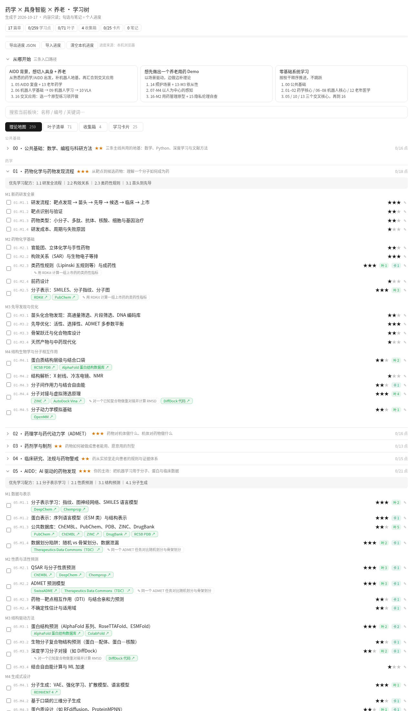

# 药学 × 具身智能 × 养老 · 学习树

> 一棵为「AI 药物发现（AIDD）+ 具身智能 + 智慧养老」交叉方向准备的学习树：**理论是树，项目是叶子**。
> 只做索引、顺序和取舍，告诉你「先学什么、做什么练手」，不提供详细教程。



## 三分钟上手

1. **打开网站**：<https://elizayue.github.io/pharma-embodied-eldercare-tree/>——不用安装，也不用注册。
2. **选一条入门路径**：展开页面顶部的「从哪开始」，按你的背景选一条路线。
3. **展开篇章，再点一个学习点**：学习点下方会出现「学什么 / 学完能回答的问题 / 入门阅读」，以及挂在这个点上的学习卡片和叶子（项目 / 练习）。全部 17 个篇章、259 个学习点都已有指引，每个篇章顶部还有一条有序的「学习路线」。
4. **记录进度**：勾选框标记已完成，✎ 写个人笔记。这些**只保存在你自己的浏览器里**，不会上传到任何地方。
5. **保存 / 迁移进度**：「导出进度 JSON」可以把进度放到任何地方（本地文件夹、网盘）；换电脑或换浏览器时用「导入进度」恢复。
6. **离线使用**：下载本仓库（Code → Download ZIP），解压后双击 `index.html` 即可。
7. **反馈**：发现错误或想补充内容，欢迎提 [Issue](https://github.com/elizayue/pharma-embodied-eldercare-tree/issues) 或 Pull Request。

## 怎么用

**直接双击 `index.html`**（或 `dashboard/tree.html`，两者内容相同）用浏览器打开即可——单文件、离线可用、不需要 node 或服务器。

- **理论地图**：17 个篇章（枝干）→ 69 个模块 → 259 个学习点（枝节），星级 = 推荐学习 / 深入程度，每篇章附「优先学习配方」。点击学习点即可展开：学什么、自检问题、入门阅读，以及挂在该点的卡片与叶子（每个篇章顶部附有序「学习路线」）。
- **叶子清单**：71 片叶子（真实项目 / 工具 / 数据库 + 无链接的动手练习），每片都挂在树上的某个节点。
- **学习卡片**：25 张粗粒度索引卡（AlphaFold、RT-2、π0、Beers 标准等），每张都有「是什么」（一句定义）和「怎么用」（典型用法与上手工具），外加挂载点、关键词和接下来学什么；一屏看完，不写成笔记。
- **收集箱**：暂时没空学的项目 / 论文先放这里，学完再「毕业」成卡片或叶子。
- 支持搜索；学习点、叶子、卡片之间可以点击互相跳转；断链节点标红。
- 不想打开网页？看 Markdown 版大纲：[`tree.md`](./tree.md)。

### 四条主线

| 主线 | 篇章 |
| --- | --- |
| 公共基础 | 00 数学、编程与科研方法 |
| 药学 | 01 药物化学与药物发现 · 02 药理与药代（ADMET）· 03 药剂与制剂 · 04 临床、法规与药物警戒 · 05 AIDD |
| 具身智能 | 06 机器人学基础 · 07 感知 · 08 控制与规划 · 09 强化 / 模仿学习 · 10 具身大模型与 VLA · 11 仿真与 Sim2Real |
| 养老 | 12 老年医学与慢病 · 13 老年药学（多重用药与依从性）· 14 照护服务与智慧养老 · 15 伦理、隐私、政策与标准 |
| 交叉应用 | 16 养老机器人与 AI 用药安全（用药提醒、智能药盒、自动化药房、跌倒检测、陪护、人在回路） |

## 个人数据：与公共内容分离

公共内容（树本身）在仓库里；**你的勾选进度和笔记从不写进仓库文件**：

1. **默认存浏览器 localStorage**：勾选框 = 已完成，✎ = 个人笔记，自动保存在本机这个浏览器里。
2. **导出 / 导入 JSON**：点「导出进度 JSON」下载 `personal.local.json`，放到你想放的地方（推荐 `progress/personal.local.json`，或任意本地文件夹 / 网盘同步目录）；换浏览器或换电脑时点「导入进度」合并回来。
3. **私有离线看板（可选）**：`python scripts/export-dashboard.py --progress progress/personal.local.json` → 生成内嵌你进度的 `dashboard/tree.private.html`。
4. `.gitignore` 已排除 `*.local.json`、`progress/` 下除示例外的所有文件、`*.private.html`、`*.local.ts`——公开仓库里不会出现个人数据。提交前仍建议 `git status` 看一眼。

> 注意：localStorage 跟随「浏览器 + 文件路径」，清理浏览器数据或移动文件夹后可能看不到旧进度，请定期导出备份。

## 改内容 / 扩展这棵树

```bash
# 1. 理论地图：编辑 content/theory-outline.md（唯一手写源）；
#    学习点指引与学习路线：编辑 content/guides/<篇章id>.md（格式见 content/guides/05.md），然后
python scripts/generate-theory.py     # → src/data/theory.ts + src/data/guides.ts（生成物，勿手改）
# 2. 叶子 / 卡片 / 收集箱 / 入口路径：直接编辑 src/data/leaves.ts、cards.ts、inbox.ts、content.ts
# 3. 校验 + 导出
python scripts/check-tree.py          # 断链、id 唯一、卡片 tags 数量、源与生成物同步、公共数据不含个人进度
python scripts/export-dashboard.py    # → dashboard/tree.html + index.html
python scripts/export-markdown.py     # → tree.md
python scripts/check-links.py         # （可选，需联网）校验指引里的入门阅读链接能否打开
```

只需要 Python 3（标准库），不依赖任何第三方包。数据约定（叶子 `anchor` 三级落脚、卡片 `target` / `next` 只能指向树上节点等）详见 [`AGENTS.md`](./AGENTS.md)。

## 内容原则与免责声明

- 只收录通用、可核实的知识点与一手链接；拿不准的细节宁缺毋编（卡片 `date` 不确定就不填）。
- 法规、指南与标准（如 Beers 标准、ICH 指南、各国政策）会更新，请以官方最新版本为准。
- **本项目仅用于学习，不构成任何医疗或用药建议。** 涉及用药的原型项目必须设计「人在回路」与专业人员兜底。

## 致谢

结构、数据模型与单文件看板导出思路参考自 [S2AI](https://github.com/chenxiaoyu0505/S2AI)（MIT License, Copyright (c) 2026 cxy）。改编文件清单与许可原文见 [`THIRD_PARTY_NOTICES.md`](./THIRD_PARTY_NOTICES.md)。学习树内容为本项目新写。

## 许可

- **代码：保留所有权利。** `scripts/` 下的脚本与页面模板、页面的结构 / 样式 / 脚本、`src/data/*.ts` 中的类型声明等代码，版权归 elizayue 所有，未经书面许可不得使用、复制、修改或分发，见 [`LICENSE`](./LICENSE)。如需授权，请通过 GitHub 联系 [@elizayue](https://github.com/elizayue)。
- **内容：[CC BY 4.0](https://creativecommons.org/licenses/by/4.0/deed.zh-hans)。** 篇章、学习点、指引、叶子、卡片、收集箱条目及其生成 / 导出文件，可以自由复制、改编、定制（含商用），注明出处即可，署名格式：「来源：elizayue/pharma-embodied-eldercare-tree，CC BY 4.0」。具体路径见 [`LICENSE-CONTENT.md`](./LICENSE-CONTENT.md)。
- **改编自 S2AI 的部分仍保留 MIT。** 源自 [S2AI](https://github.com/chenxiaoyu0505/S2AI) 的部分继续按其 MIT License（Copyright (c) 2026 cxy）提供，我在其上的修改与新增保留所有权利，见 [`THIRD_PARTY_NOTICES.md`](./THIRD_PARTY_NOTICES.md)。
- **第三方资料归各自权利人。** 内容中引用的论文、数据库、指南、课程等，版权与使用条款以其原始来源为准，不在本仓库许可范围内。
- **旧版本说明：** 本次许可调整之前发布的版本以 MIT License 发布，已获得这些版本副本的人仍可按 MIT 使用；新许可只适用于本次调整及之后的版本。
